With a free day and itchy feet, we headed out to **Pasir Ris**, ready for a day on the water. Our destination: _Adventure Paddlers_, a small outfit tucked away on the coast that rents out kayaks for exploring the wild side of Singapore.

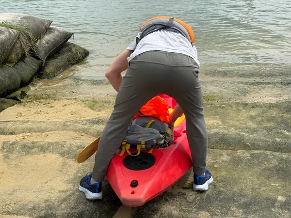

After a quick gear-up and safety check, we slid our boats into the water without too much drama. Spirits were high—until we looked out at our first challenge: **a shipping lane**.

### **The Sketchy Crossing**

Crossing a shipping lane in a kayak feels exactly as nerve-wracking as it sounds. We timed our sprint between distant cargo ships, paddling hard while trying not to think about how tiny and fragile our kayaks felt compared to the hulking silhouettes on the horizon.

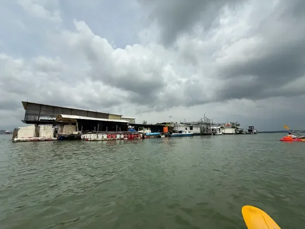

Some slightly elevated heart rates later, we reached the other side in one piece and stumbled across something unexpected: a **floating restaurant and shop**, bobbing gently in the current. It felt surreal to paddle past people eating lunch while we were out there on a salty mini-expedition.

### **Into the Mangroves**

Leaving the open water behind, we slipped into the narrow, winding channels of **Pulau Ubin’s mangroves**. The atmosphere shifted immediately—the sounds of engines and city life faded, replaced by birdsong, rustling leaves, and the occasional splash of fish.

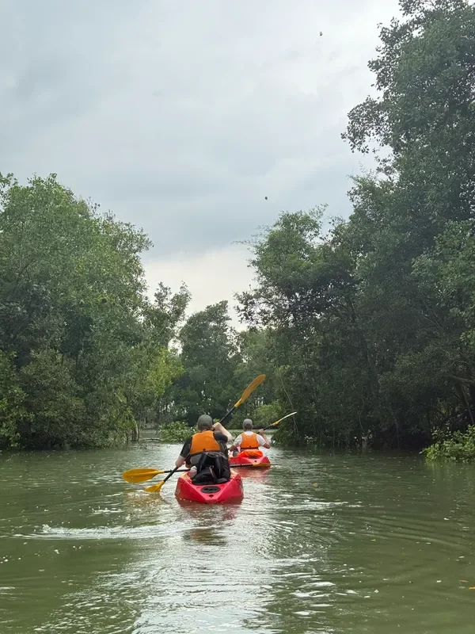

We’d heard rumours of crocodiles here, so every ripple on the surface had us scanning nervously. At one point, we caught a fleeting glimpse of what we _think_ was an otter darting back towards the sea—a tiny wildlife win to keep our excitement levels up.

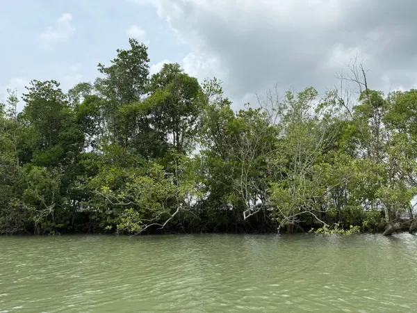

Then, without warning, **the heavens opened**. Tropical rain doesn’t mess around; within seconds, we were completely drenched. We huddled beneath low-hanging branches where we could, laughing at the absurdity of it all before pushing onward through sheets of warm rain.

### **Rusty Obstacles and Strange Outposts**

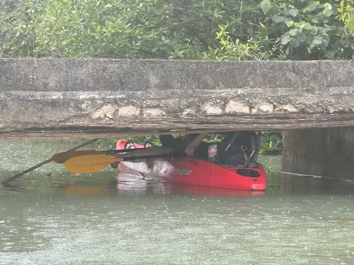

As the tide shifted, we encountered a **low, crumbling bridge**. The concrete was spalling, rebar jutting out like rusty teeth. With some careful manoeuvring—and only a few minor scratches—we managed to squeeze under.

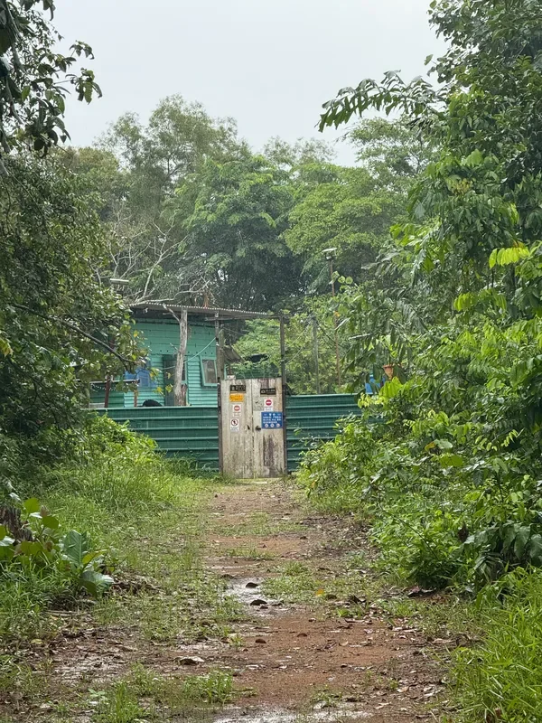

Beyond the bridge, the river widened and we discovered a **small concrete jetty**, the perfect spot for a much-needed break. We clambered out, stretched our legs, and followed a path inland, stumbling across a strange, slightly eerie outpost surrounded by jungle. Its purpose? Total mystery.

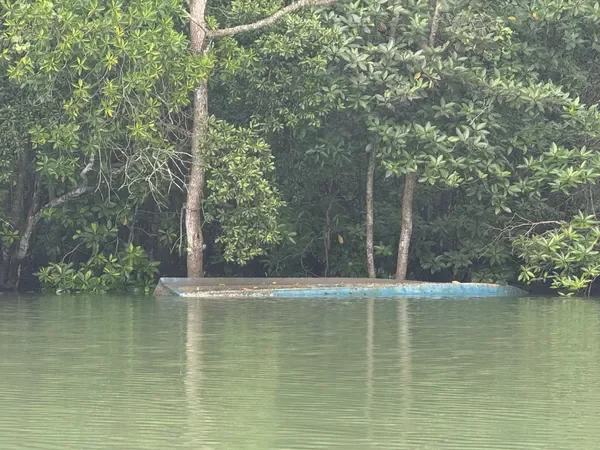

Curiosity satisfied, we dragged our kayaks over the jetty and relaunched on the other side. The next stretch of river took us past the **sunken wreck of an old boat**, a ghostly reminder of the sea’s power, and later alongside the far side of the outpost, where dozens of working boats were moored.

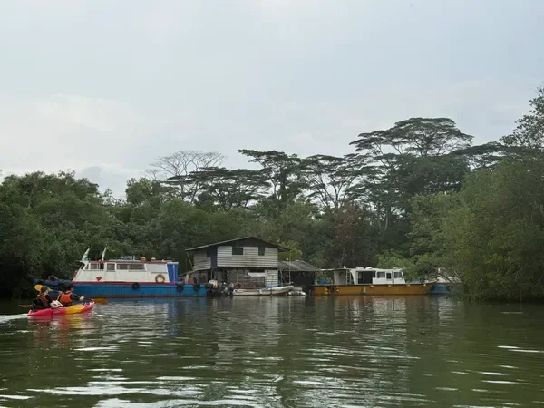

### **The Brutal Return Crossing**

Eventually, we emerged back onto the open water, passing the floating restaurant once again. But this time, the return crossing was **so much worse**. A headwind kicked up, our arms were tired, and every paddle stroke felt like it barely moved us forward.

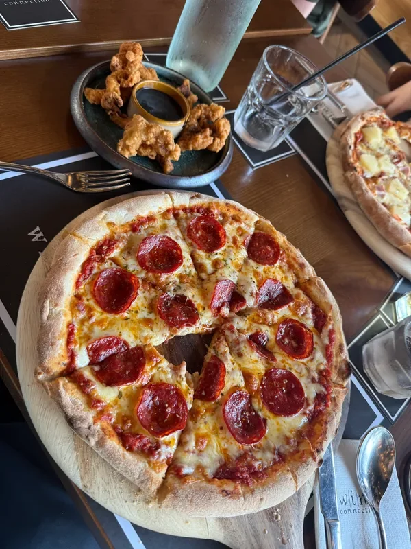

The only silver lining? Less boat traffic meant fewer near-misses to worry about. By the time we finally hit the beach, our shoulders were burning and our stomachs were growling. We hauled the kayaks ashore, handed them back to Adventure Paddlers, and immediately set our sights on **Wine Connection**, where we demolished some well-earned food and drinks.

### **Winding Down in Pasir Ris Park**

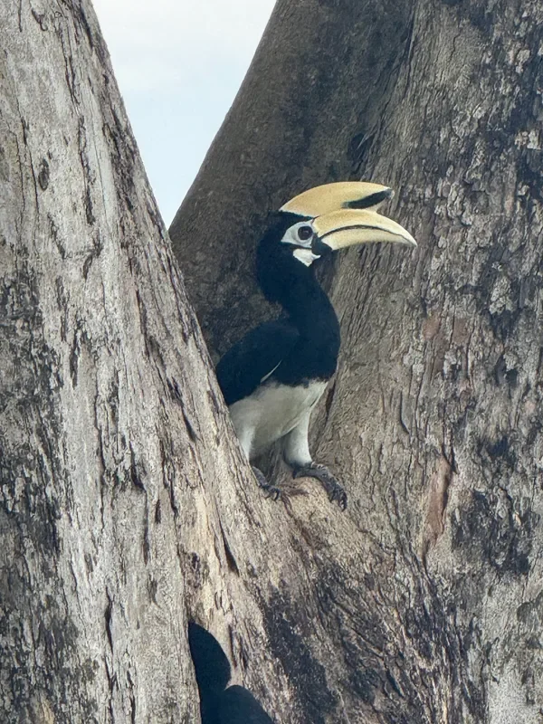

With renewed energy, we wandered through **Pasir Ris Park**, spotting **monitor lizards, terrapins, and some seriously cool birds** along the way. It was the perfect low-key end to a high-intensity day.

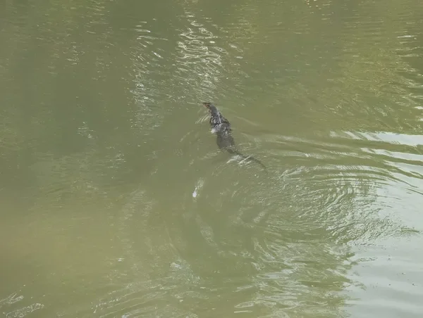

By the time we called a Grab home, we were sunburnt, salt-streaked, and thoroughly spent. It had been a day of sketchy crossings, surprise wildlife encounters, and hidden mangrove mysteries—a perfect example of how even in one of the world’s busiest cities, adventure is always just around the corner.