Like all great Singapore-based adventures, this one started at **Changi Airport** on a Friday evening. After a _cheeky Burger King_ dinner and a last-minute grab of **family-sized bags of M&Ms** (essential adventure fuel), we breezed through security and were soon boarding our flight to Bali.

Touchdown was easy thanks to our **e-Visas on arrival**—highly recommended if you don’t fancy queueing—and before long, we were in a taxi winding our way to **The Niche Bali**, our home base for the weekend. The room wasn’t anything to write home about, but after a long day of work and travel, we didn’t care. We set an early alarm and crashed out, ready for two days of dirt biking chaos.

* * *

**Day One: Mud, Mechanical Mayhem, and Black Sand Beaches**
-----------------------------------------------------------

Bleary-eyed and not quite awake, we were whisked to the bike base first thing in the morning. Our steeds for the day: **two Yamaha 250cc four-strokes**.

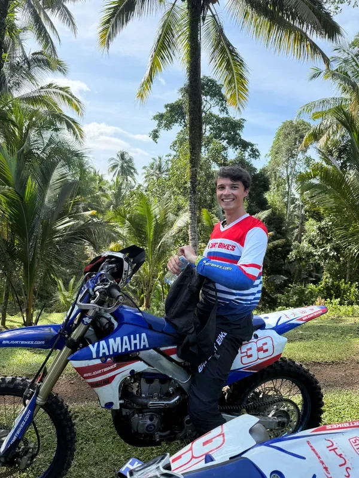

To our surprise, there was _a lot_ of road riding before we even touched dirt. This is mildly terrifying when you don’t technically have the legal right to be there. We weaved between stray dogs, mopeds stacked with entire families, and trucks that definitely wouldn’t notice us if they ran us over.

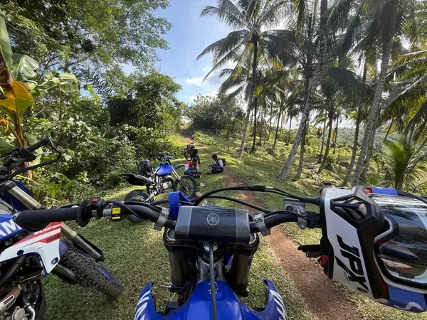

Finally, we got a taste of freedom on a dusty little off-road track. We opened up the throttles, got hooked instantly… and then immediately hit a **slippery uphill road** where Arthur lost traction and gracefully crashed. Luckily, no cars were around to witness it, and both rider and bike survived with just bruised egos.

* * *

### **The Jungle Eats Bikes Alive**

We carried on, bouncing between backroads, rice fields, and proper off-road sections. Then Ollie’s bike decided to **cut out completely**, forcing a half-hour roadside wait while someone fetched a spare.

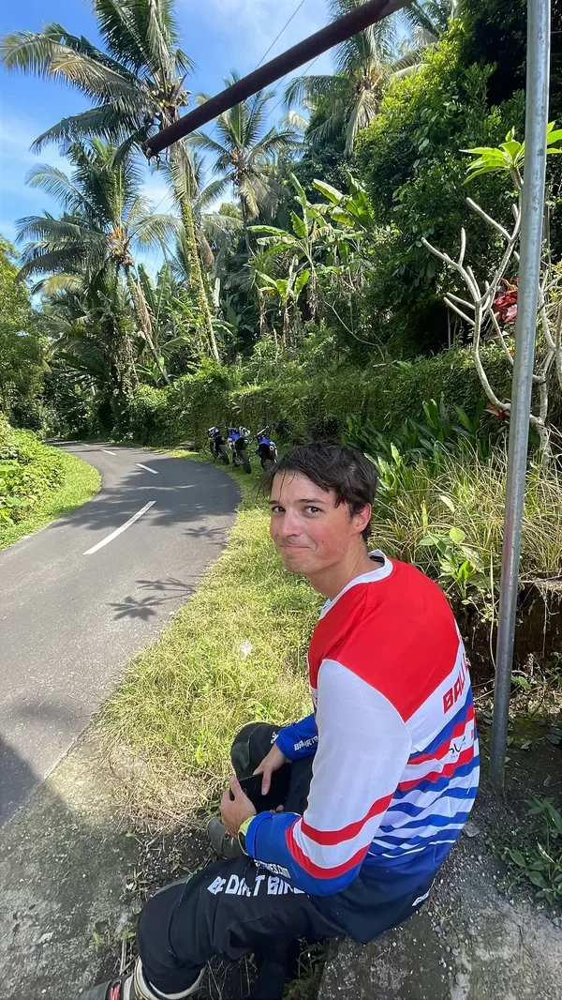

The jungle trail itself was a whole new challenge. Heavy rain the night before had turned the dirt to **slick, treacherous mud**. Even the guides were sliding around. Gnarly hill climbs tested us to the limit, and an hour of intense riding later, we were absolutely spent. When the guides suggested breaking for lunch, we didn’t need convincing.

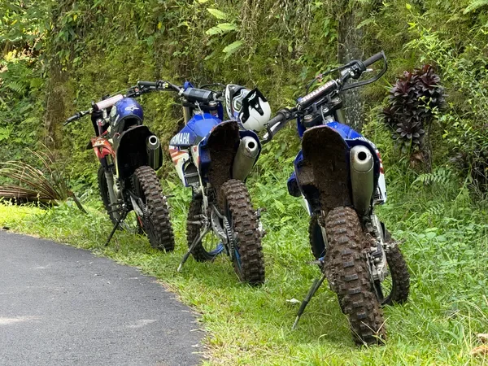

But Bali wasn’t done messing with us. Ollie’s _replacement bike_ started cutting out too, right on a sketchy road section. After a quick swap with one of the guides, we limped to a small roadside restaurant where we inhaled fried rice and fish while the guides poked at the broken bike.

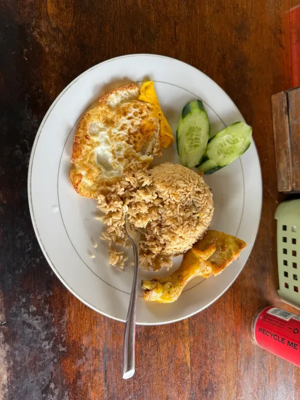

Then came the bad news: no more spare bikes.  
The plan? Cancel the rest of the day and refund us.  
The problem? We’d flown _all the way to Bali_ for this.

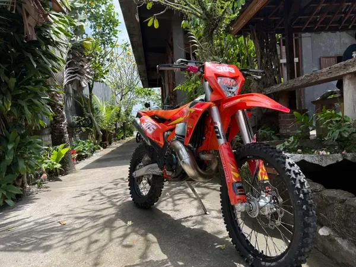

Cue a dramatic entrance by the boss, who rolled up and declared there’d be **no refunds**—but instead offered Ollie a **300cc KTM two-stroke**.  
Problem solved. Energy restored. Chaos resumed.

* * *

### **From Dirt Tracks to the Beach**

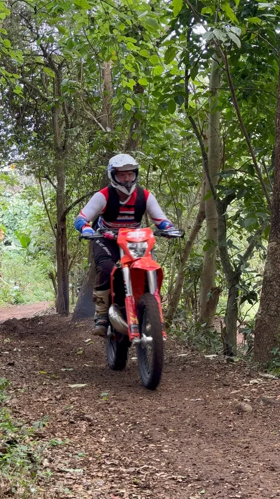

The afternoon kicked off at a **private off-road track**, where we got to ride freely, swapping bikes and testing limits. The KTM was an instant upgrade: smoother power, way more fun, and somehow less cursed… for now.

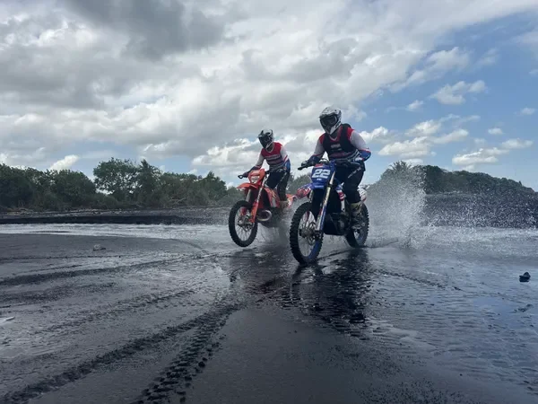

The final stretch of the day took us to **Bali’s black sand beaches**, where we opened the throttles wide and _sent it_. The surreal mix of roaring across the sand, splashing through a river mouth, and skimming the edge of the ocean was pure dirt biking bliss.

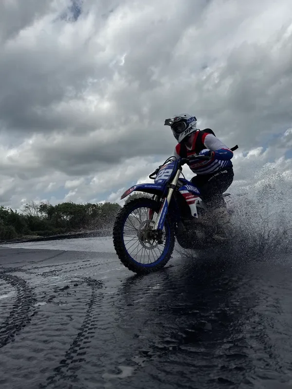

With the sun setting, we rode back to base (mercifully uneventful), sat through a brutal traffic-clogged transfer, and finally collapsed at the hotel. Dinner at **Crumb and Coaster** was a highlight—fuel for sore muscles—before Ollie haggled for some **rice hats** on the walk home. Day one: complete carnage, but a total success.

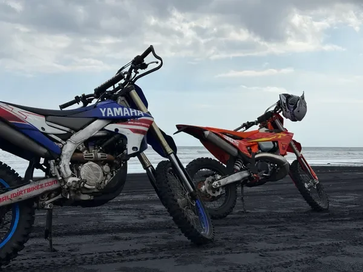

* * *

**Day Two: Riding a Volcano**
-----------------------------

Another early morning, another long transfer—this time to **Mt. Batur**, an active volcano surrounded by stunning scenery. The landscape alone made the trip worthwhile, but we were here to **ride volcanic sand**, not just look at it.

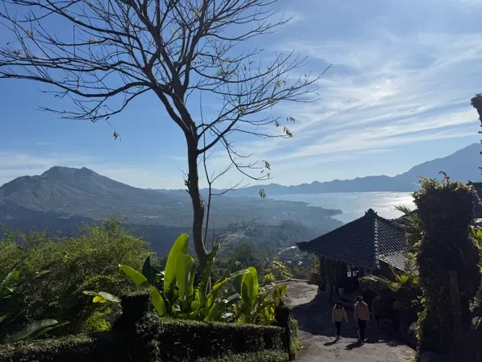

We joined up with a group of more experienced riders and dropped into the crater. The terrain was unreal: soft, black sand that swallowed tires and begged for throttle. We tore around like kids in a sandbox, practicing hill climbs and dune jumps. Some climbs were doable, others… less so, resulting in some spectacular fails.

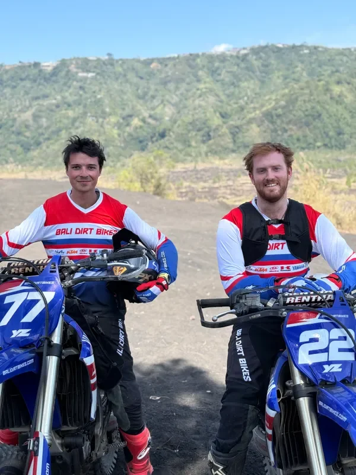

* * *

### **The Curse of the Bikes, Continued**

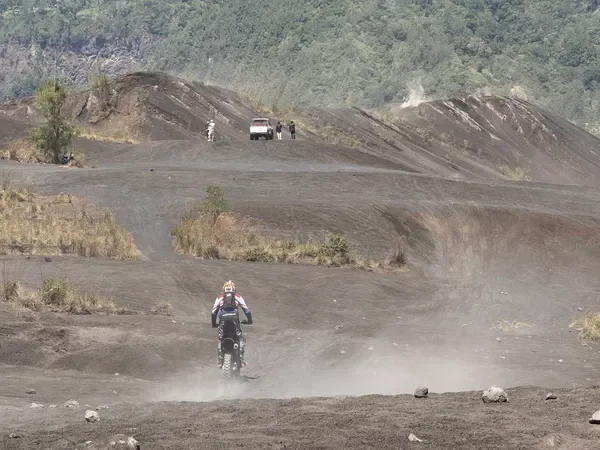

True to form, Ollie managed to **break another starter button** after dropping a bike on a steep downhill. Bike four, gone. Replacement delivered, we carried on—until _bike five_ began bogging down like the cursed machines from day one. Another swap with a guide, another limping return to base. At this point, we were just laughing at the tally.

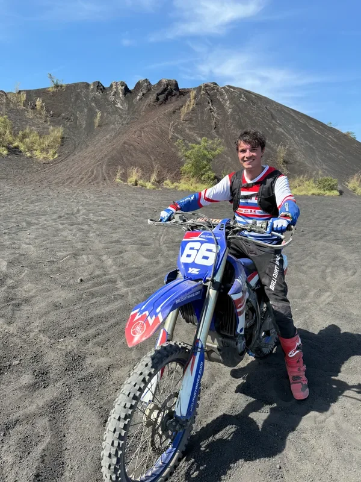

Lunch was a **delicious buffet** with panoramic volcano views, a well-earned moment of peace after a chaotic morning. Then it was back to the hotel for some well-deserved pool time, before a final evening flight back to Singapore.

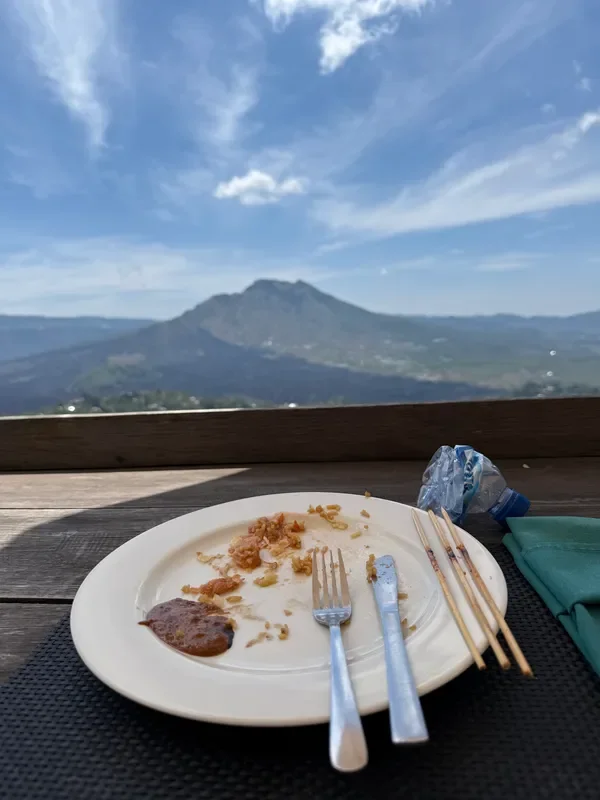

* * *

**Final Tally**
---------------

In two days of riding, Ollie managed to **break five bikes** and ride **seven different machines**, while Arthur impressively kept his single Yamaha unscathed.

The **volcano riding** at Mt. Batur was hands-down the highlight: accessible for all skill levels, utterly unique, and ridiculously fun. The jungle riding, while epic, was a serious challenge—especially after heavy rain.

Would we do it again? Absolutely.  
Would we buy insurance first? Also absolutely.