We woke up at a reasonable hour, grabbed our bags, and headed over to **HarbourFront**, ready to swap skyscrapers for sea spray. A quick raid of **7-Eleven** for breakfast and lunch supplies later, we found ourselves trying to figure out how this whole ferry thing worked.

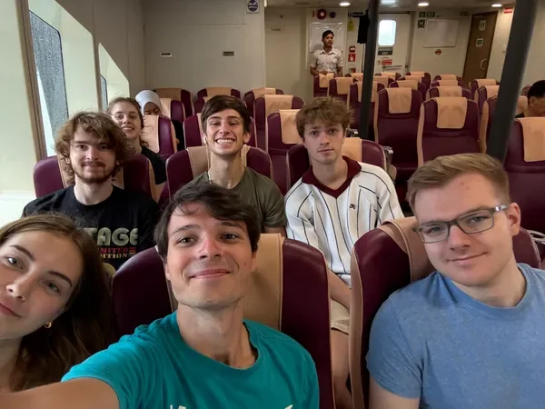

Turns out, boarding a ferry here is a lot like boarding a plane.  
First stop: a counter upstairs to get **printed boarding passes**, then through security and passport control before being herded into a **cramped holding pen** that felt _far too much like an airport waiting lounge buried inside a shopping mall_. Singapore never fails to surprise.

* * *

**A Rocky Start – Literally**
-----------------------------

The ferry boarded smoothly, and soon we were bouncing across the waves on our way to **Batam, Indonesia**. Ominous grey clouds hung overhead, and the sea looked… unfriendly. Midway through the journey, a message pinged in: **our jet ski booking might be cancelled** due to rough conditions.

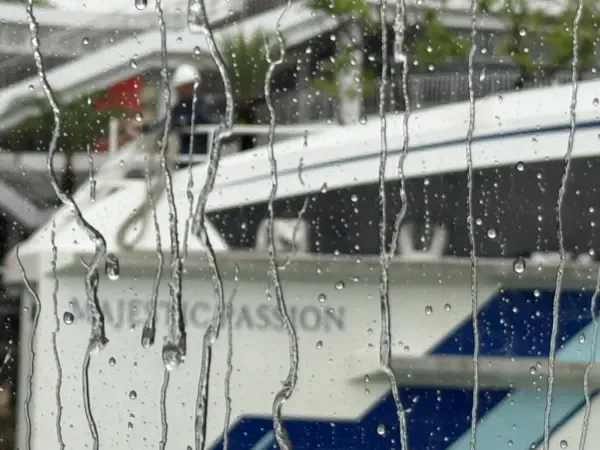

The mood sank almost as quickly as our breakfast snacks. Still, we crossed our fingers and kept going. The ferry ride was a little bumpy, but otherwise uneventful, and in just over an hour we were stepping onto Indonesian soil.

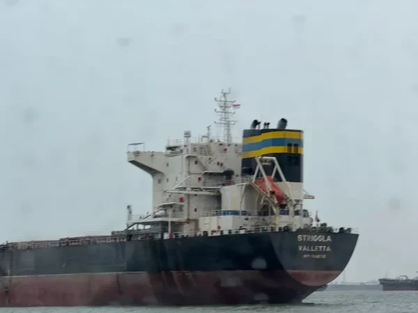

* * *

**Matthew vs. Immigration**
---------------------------

Immigration was a split experience. Most of us, having correctly filled in our **arrival cards and e-Visas**, sailed through the **e-Gates**.

Matthew… did not.  
Turns out, when he scanned his passport with his phone camera, the system mistook one of the numbers **“1” for an “L”**, which caused the e-Gate to reject him completely.

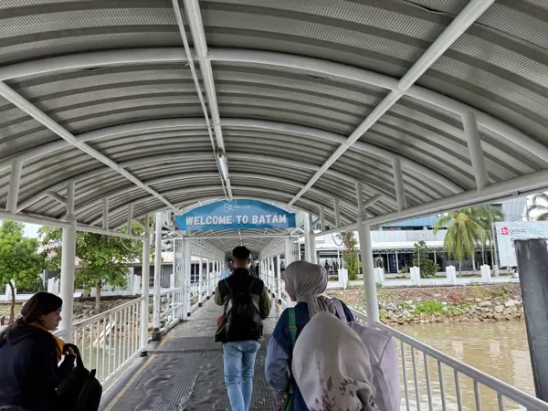

As he tried to explain this to a very confused immigration officer, we were **ushered through security**, told we couldn’t wait for him. Meanwhile, our jet ski booking time was rapidly approaching. Eventually, we split the group:

*   **Team Matthew Rescue:** waited to get him through.
    
*   **Team Recon:** jumped in a taxi to see if we could even _still_ jet ski.
    

* * *

**Batam Traffic = Chaos**
-------------------------

The taxi ride was a mini-adventure. Picture **cars on the wrong side of the road**, pedestrians casually jogging _against the flow of traffic_ on a dual carriageway, and a general vibe of “organised chaos.” Somehow, it worked—and added to Batam’s charm.

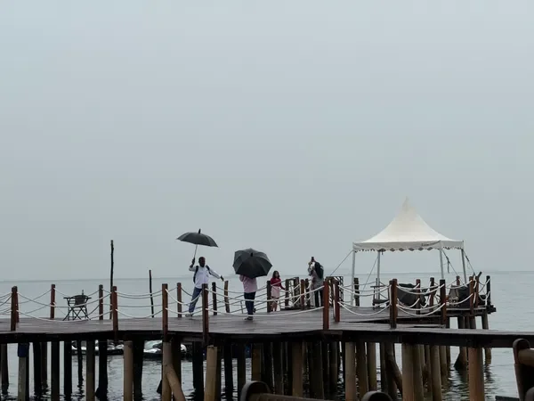

The first group reached **Elite Sea Sport**, only to be told we’d have to **wait 30 minutes** and see if the sea calmed enough to head out. Luckily, this gave Matthew time to finally clear immigration and join us.

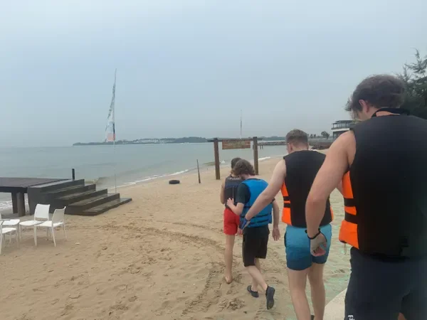

By the time everyone was reunited, we got the good news: **we were riding the full two hours we’d booked**. Major relief.

* * *

**Matthew’s Wardrobe Malfunction**
----------------------------------

As we geared up, disaster struck again—Matthew realised he’d **forgotten his swimming trunks**, arguably the _one essential piece of kit_ for jet skiing. With no other choice, he decided to just wear **his only pair of shorts**, hoping they wouldn’t get too wet.  
Foreshadowing: they very much did.

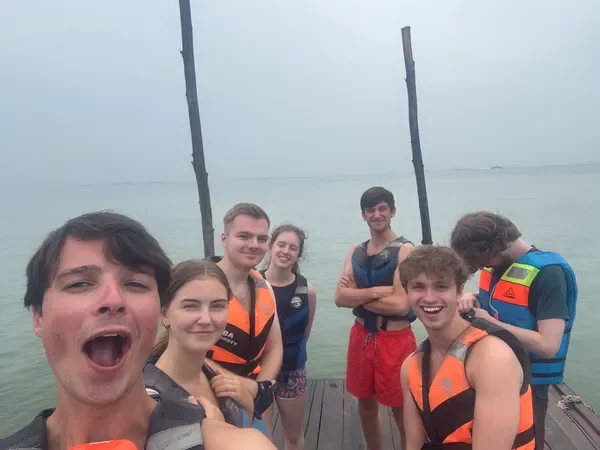

We stashed our bags in lockers, handed Ollie’s phone to the guide for photos (who promptly removed it from Dan’s waterproof case and stuffed it into their buoyancy aid…), and gathered for a vague safety briefing. Then, it was time to ride.

* * *

**The Best Two Hours of Our Lives**
-----------------------------------

The moment we hit the water, it was chaos in the best possible way. The waves were rough, tossing our jet skis around, but once we found our rhythm, we were **launching off waves**, getting serious air, and racing past the guide—who was somehow balancing Ollie’s phone while snapping photos like a daredevil influencer.

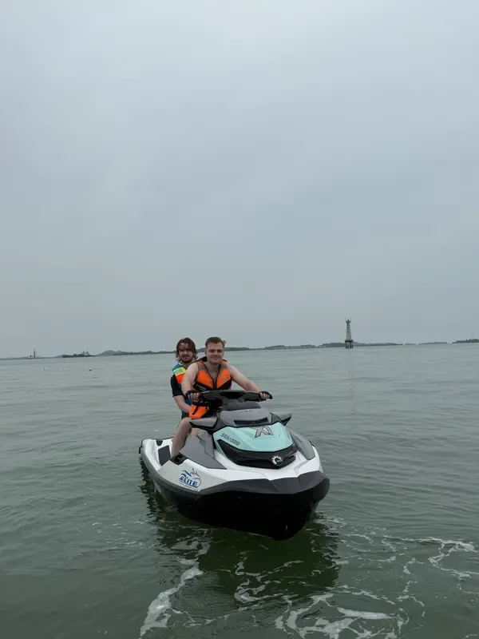

It quickly became clear that **Elliot and Sam’s jet ski was way faster** than the rest. Later, we learned they’d been given the **“expert key”** by mistake, derestricting the engine. While the rest of us topped out at 30 km/h, they were blasting along at **55 km/h**, leaving only salty spray in their wake.

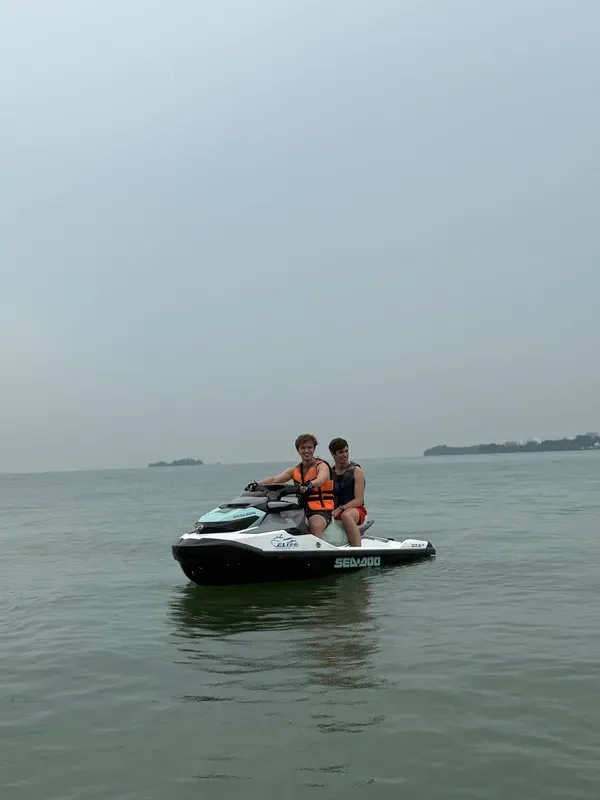

Racing each other, weaving close enough to create splash wars, we found out just how easy it is to absolutely drench your friends. One particularly ambitious pass from Ollie and Tiana left Matthew—riding behind Dan—**soaked to the bone**, drenching his _only_ shorts.

* * *

### **Halfway Stop: Beach + Abandoned Building**

We zipped past container ships and uninhabited islands before stopping halfway at a quiet beach. Nearby stood a **huge, eerie abandoned stilt building**, which felt like something straight out of a movie. We snapped photos, rehydrated, and swapped drivers before heading back out to sea.

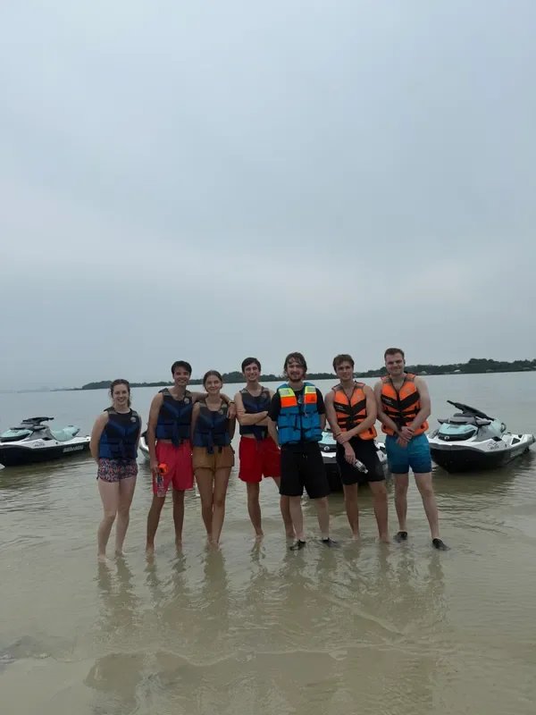

The second half of the ride was just as wild—until a sharp turn by Dan **launched Matthew clean off the back** of their jet ski and into the water.  
Elliot, with perfect _man overboard_ training, immediately started **pointing and shouting**, despite being about four feet away. No one seemed to realise you were supposed to _pick the guy up_, so Matthew just bobbed in the waves until the guides circled back to rescue him.

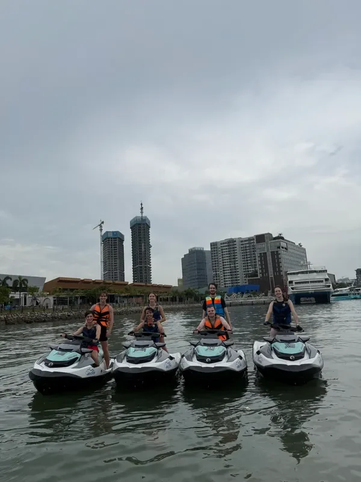

Now completely soaked—again—he climbed back on.

* * *

**Flat-Out Finale**
-------------------

With the clock ticking, we made one last run back toward base, Elliot and Sam still blasting past everyone like show-offs. Back on shore, we peeled off wet clothes while Matthew sat in his underwear, leaving his shorts to dry in the sun.

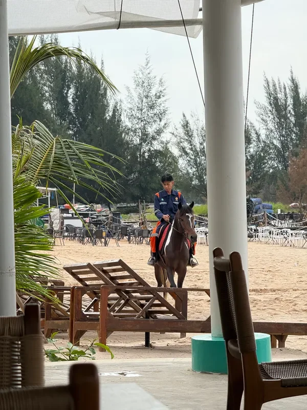

We ordered lunch, expecting a quick bite… only to wait **an entire hour**. When the food finally arrived, we had about **four minutes to eat everything** before sprinting to make the ferry.

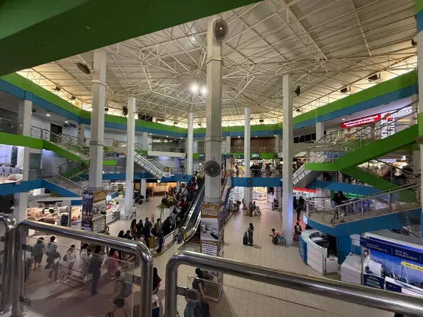

Matthew borrowed a pair of Fiona’s spare trousers (thankfully), and we hustled back to immigration—this time, he sailed through without issue. The return ferry was sleepy and calm, delivering us back to HarbourFront after a day of total madness.

* * *

**A Day of Absolute Chaos**
---------------------------

From **immigration disasters** to **high-speed wave jumping**, this trip had everything. The jet skiing itself was hands-down one of the **best activities we’ve done in Singapore**, full of adrenaline, laughter, and near misses.

As for Matthew’s shorts?  
Let’s just say they didn’t survive the adventure.