Day 1 – The Airport & Jervinio the Frog
---------------------------------------

Leaving St James Power Station at 4:45pm leaves more than enough time to catch a flight at 7:55pm for future reference. Rocking up to Terminal 4 at Changi Airport proved a very easy and stress-free start to the holiday (Other than Matthew convincing Elliot he needed to wear all his clothes to make his bag weigh under the limit).

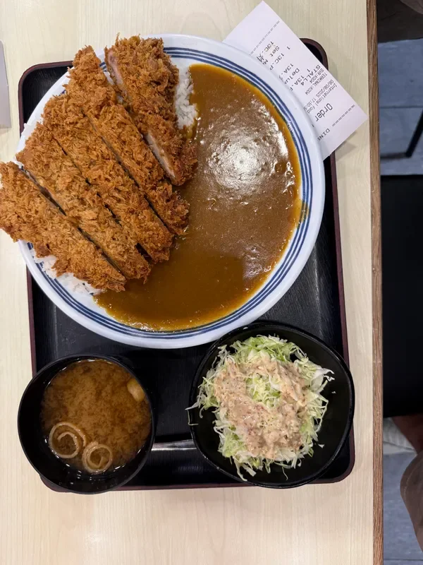

After fuelling up on airport food and 7/11 snacks, we boarded a delayed flight and landed in Bali around midnight. Our driver, Agung, greeted us at arrivals—he looked about 14, had the limpest handshake known to mankind but was very kind, and drove us through a swarm of mopeds.

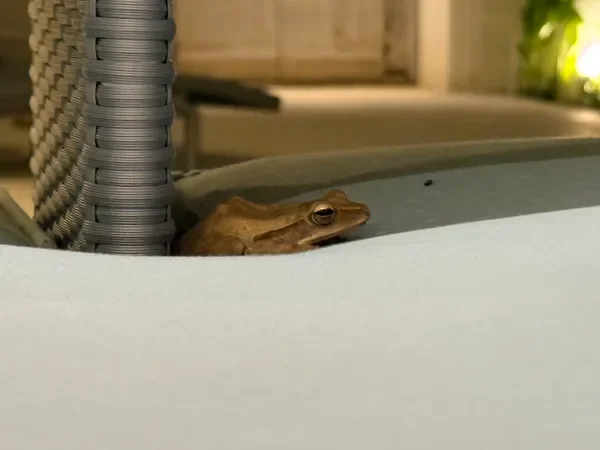

At 1am, we finally arrived at our villa. The pool glowed a suspicious shade of swamp green, and we immediately met our housemate for the week: Jervinio the frog. He lived by the pool and became our unofficial mascot. Matthew and Sam, ignoring the colour of the water, jumped straight in. Matthew, however, refused to dunk his head under because, in his words, “you don’t know what’s in there.”

Day 2 – Quads, Monkey Business & the Submarine Umbrella
-------------------------------------------------------

By 9am the next day, Legi, our driver for the day, had us packed into his van for a full tour. First stop: ATVing. We were handed helmets, wellies, and free glasses of something that tasted suspiciously like piss water. The ride itself was chaos—Matthew lost a wheel, Ollie’s quad kept stalling, the “water crossings” were ankle deep at best, and we all finished caked in mud.

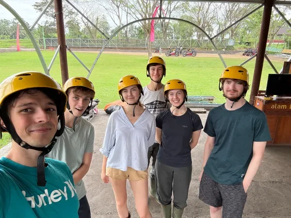

Lunch afterwards was our first proper Indonesian food (which came with “poo sticks”—still don’t know what they were). Then it was onto the Monkey Forest, which was meant to be wholesome… until Elliot clicked his fingers at a monkey, and the monkey bit him. His immediate reaction wasn’t pain—it was panic about whether the monkey had its jabs. Meanwhile, Sam had disappeared with our guide to hunt down an ATM. Classic timing.

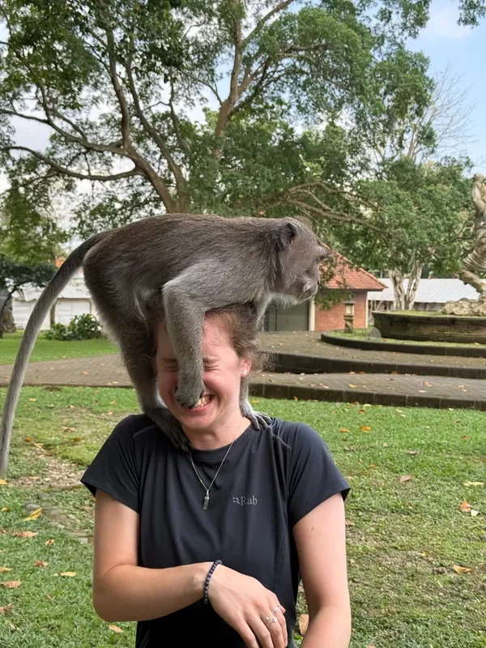

Next, we visited a waterfall, dodged waves of people trying to sell us bracelets and sarongs, and had a swim in the cool water. We attempted to cross a very Instagrammable bridge but weren’t about to pay again for the privilege, so we skipped it.

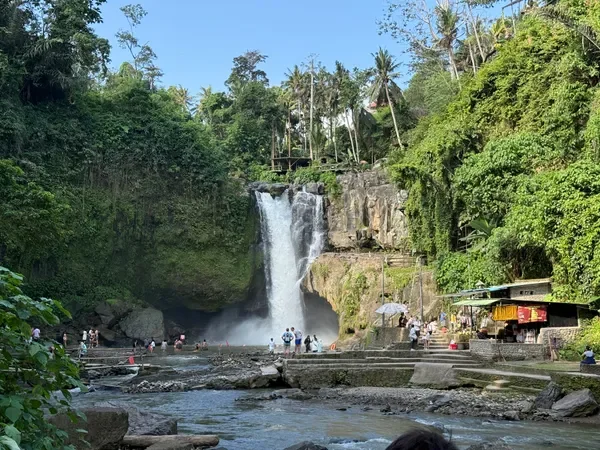

Back at the villa, the swamp pool became our sunbathing spot anyway. We ordered Mexican food, played poker, and witnessed Elliot’s most cursed invention yet: the Umbrella Submarine. Yes, he tried to use a patio umbrella as a diving bell. Yes, it broke instantly. Yes, he fixed it later.

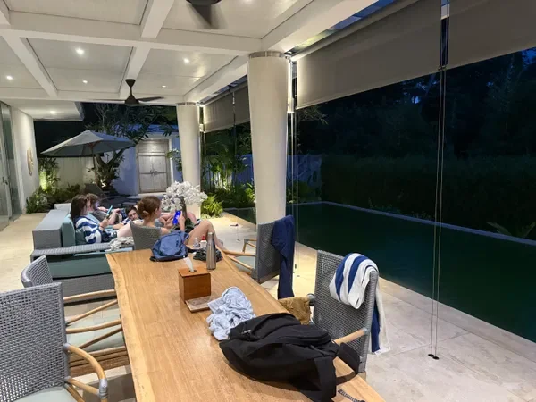

Day 3 – White Water Carnage & Mango Cider
-----------------------------------------

The morning was spent white water rafting, which quickly turned into a competitive sport. We splashed and overtook other rafts, hurled a coconut into a rival boat, and stopped midway for a very civilised riverside beer. The pickup truck rides to and from the river made it feel like we were in a Balinese version of Top Gear.

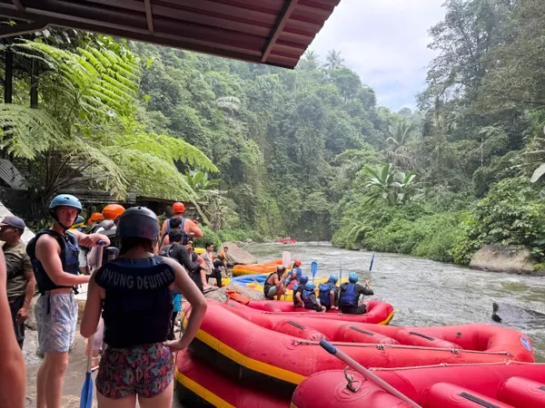

By the time we got back to the villa, the pool was miraculously cleaned. Cue hours of pool games, which mainly consisted of injuries: Elliot and Fiona battering each other with a bucket, Matthew falling onto Sam’s head, and various wrestling matches breaking out.

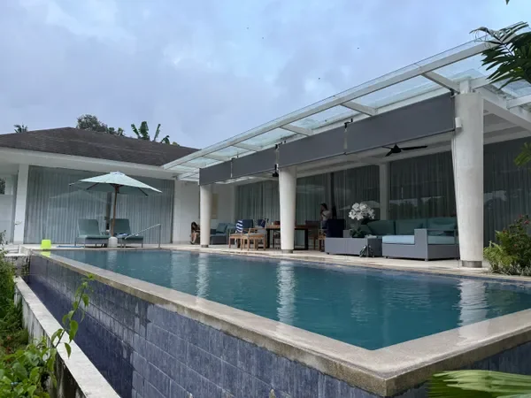

That evening, we hiked to Sayan Point hoping for a golden sunset, but we mistimed it and arrived in near-darkness. No worries though—the food was amazing and they served mango cider, which instantly redeemed the failed sunset mission. On the walk back, disaster struck: Tiana stacked it on the steep slope, not dressed for sliding, and demolished her knee. Back at the villa, she patched herself up while the Elliot, Matthew and Sam wrestled in the pool.

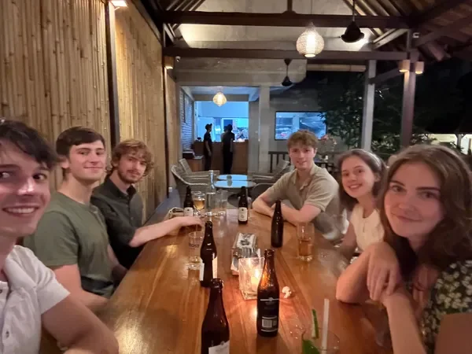

We ended the night packing up for the next leg of the trip: Komodo.

Day 4 – To Komodo (and Emergency Toilet Trips)
----------------------------------------------

The alarms went off at 4am. Security immediately confiscated Ollie’s scissors and one of Elliot’s two pairs. Elliot also spent more time in the airport toilets than anywhere else—his stomach was not on board with this trip.

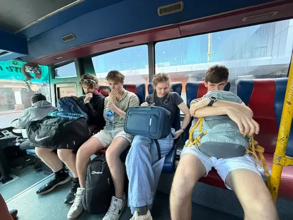

We flew to Labuan Bajo, boarded a questionable transfer boat (basically a floating wooden platform), and met our liveaboard crew for the next three days.

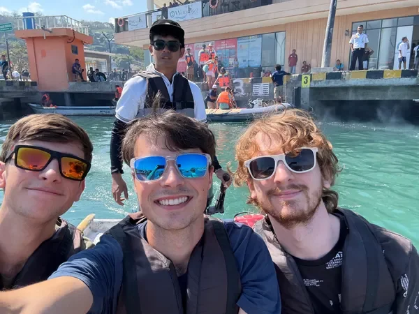

The first stop was snorkelling with manta rays—giant, graceful, and impossible to photograph properly. From there we swam over baby sharks and then headed to a sandbank where Sam heroically “rescued” a Chinese tourist from drowning… in waist-deep water.

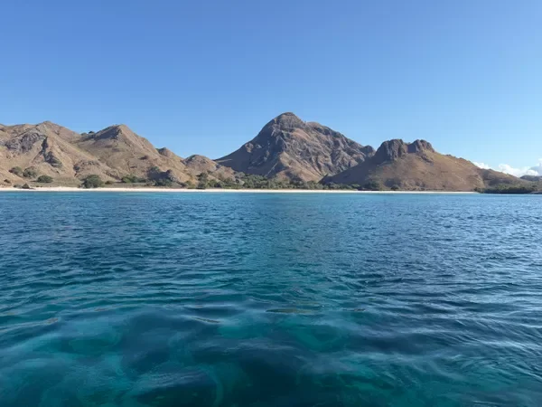

Later, we chilled on the famous Pink Beach, taking all the corny drone shots. The day finished with our first Komodo dragon sighting—an unexpectedly fast one, plus a deer wandering around for good measure. That night, we endured a seriously wavy ride to Padar Island where we slept on the boat.

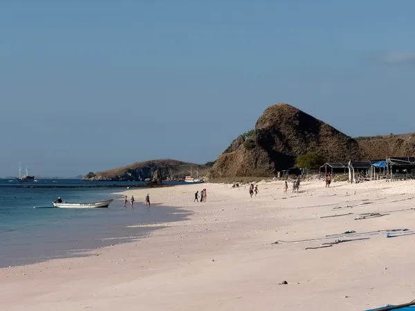

Day 5 – Dragons, Turtles & Flying Foxes
---------------------------------------

Another 4am start, this time climbing the hill on Padar Island for sunrise. The view was insane, but Sam’s timelapse was ruined by constant interruptions.

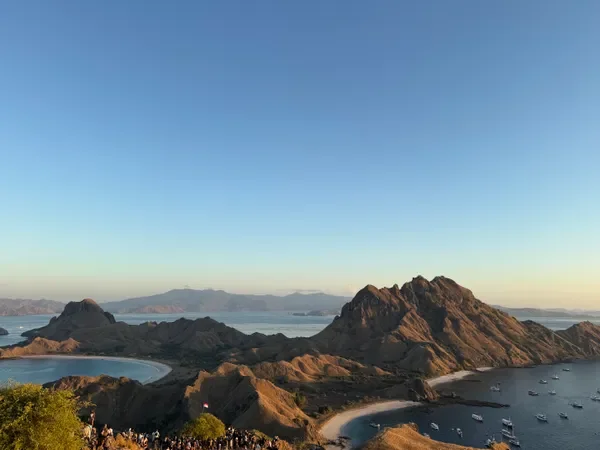

After breakfast we finally hit Komodo Island. Within minutes we’d spotted seven Komodo dragons. They looked prehistoric up close, like living dinosaurs.

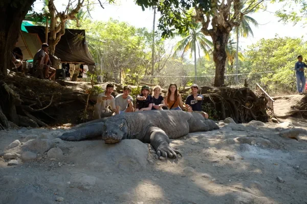

The afternoon was spent snorkelling at Strawberry Rock, where we found turtles gliding through the coral. Later, we chilled at a deserted beach, messing around with hermit crabs in the rock pools.

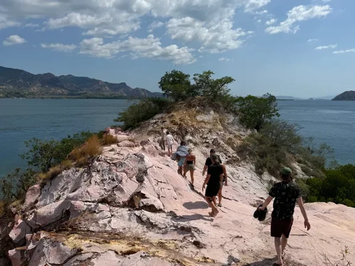

As the sun went down, we sat on the boat and watched thousands of flying foxes stream across the sky. It was one of those surreal “this is why we travel” moments.

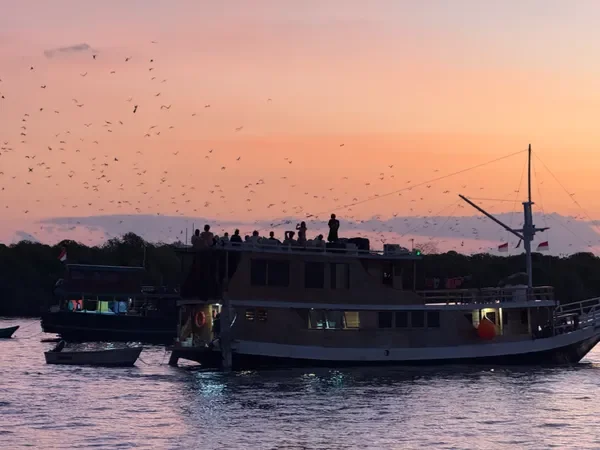

Day 6 – Baby Sharks & the Crispy Gecko
--------------------------------------

Our final morning included one last island viewpoint and a stroll along a beach full of baby sharks. Back on the boat, Sam discovered a crispy gecko corpse in the toilet, which instantly killed everyone’s appetite.

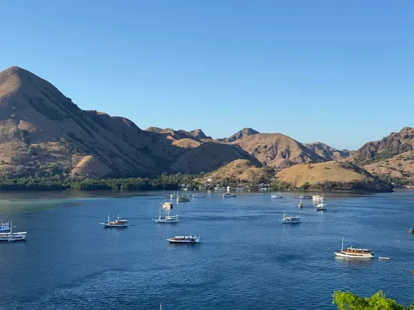

We said goodbye to our guide Toni, flew back to Bali, then killed three hours in an airport hotel when our flight to Singapore was delayed. The final hurrah was a midnight pizza back at Lyf in Singapore—one last feast before reality resumed.

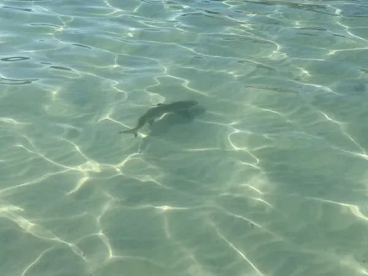

The Injury Roundup
------------------

What’s an adventure without injuries?

Elliot: Monkey bite, bucket thumb, coral cuts, sunburnt legs.

Fiona: Bucket cuts, stings, coral scrapes.

Matthew: Blister, sunburn, minor bucket damage, bitten by a fish.

Sam: Busted toe, coral cut, shin kicked by Elliot, fish bites x2.

Tiana: Knee absolutely wrecked.

Ollie: Untouched. (Still smug.)

The Verdict
-----------

Best Moments: Elliot breaking an umbrella underwater, Monkey Forest madness, pool wrestling, manta rays, flying foxes.

What Went Well: Action-packed, good vibes, villa came through in the end.

Even Better If: The pool wasn’t radioactive to start, the boat was a bit nicer, and someone turned the engine off before bed.

Overall rating: 9/10.
---------------------